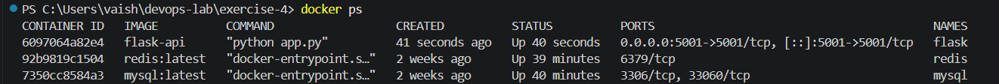

# Exercise 4: Docker Networking with Multiple Containers

## Objective

Understand Docker networking concepts and configure a multi-container application using a custom Docker bridge network.

## Scenario

Develop a multi-container application consisting of:

- **Flask:** Python web application exposing a REST API.
- **MySQL:** Relational database container.
- **Redis:** In-memory cache container.

All three containers communicate over a custom Docker bridge network named `my-bridge-net`.

## Technologies Used

- Docker
- Docker Bridge Networking
- Python
- Flask
- MySQL
- Redis
- VS Code

## Project Structure

```text
Exercise-4/
├── image/
│   ├── Network.png
│   ├── Containers.png
│   ├── Flask-api.png
│   ├── MySQL-connectivity.png
│   └── Redis-connectivity.png
├── app.py
├── requirements.txt
├── Dockerfile
└── README.md
```

The image filenames above are suggested names. Use the actual names of your saved screenshots.

---

## Task 1: Create a Custom Bridge Network

Create a Docker bridge network named `my-bridge-net`.

```powershell
docker network create --driver bridge my-bridge-net
```

Docker returns a network ID when the network is created successfully.

### Explanation

A bridge network allows containers on the same Docker host to communicate with one another. Docker also provides automatic name resolution for containers connected to a user-defined bridge network.

## Task 2: Verify the Network

```powershell
docker network ls
```

Verify that `my-bridge-net` appears in the list with the `bridge` driver.

## Task 3: Inspect the Network

```powershell
docker network inspect my-bridge-net
```

The output contains details such as:

- Network name and ID
- Network driver
- IP address management (IPAM) configuration
- Subnet and gateway
- Connected containers

In this environment, the inspected network used subnet `172.20.0.0/16` and gateway `172.20.0.1`.

The exact network ID, subnet, gateway, and container IP addresses can vary between environments.

---

## Task 4: Develop the Flask Application

Create a file named `app.py`.

```python
from flask import Flask, jsonify

app = Flask(__name__)

@app.route('/about', methods=['GET'])
def about():
    return jsonify({
        "name": "Simple REST API",
        "version": "1.0",
        "description": "This is a simple REST API built with Flask."
    })

if __name__ == '__main__':
    app.run(host='0.0.0.0', port=5001, debug=False)
```

### Explanation

- `Flask(__name__)` creates the Flask application.
- `@app.route('/about', methods=['GET'])` defines a GET endpoint.
- `jsonify()` returns the API response as JSON.
- `host='0.0.0.0'` makes the server listen on all network interfaces inside the container.
- `port=5001` specifies the port on which Flask listens.
- `debug=False` disables Flask's interactive debugger.

Listening on `0.0.0.0` is important when exposing the application through Docker port mapping.

## Task 5: Create the Requirements File

Create `requirements.txt`.

```text
Flask==2.0.1
Werkzeug==2.0.3
```

The Werkzeug version is pinned to a compatible release for Flask 2.0.1.

## Task 6: Create the Dockerfile

Create a file named `Dockerfile`.

```dockerfile
# Use the official Python image
FROM python:3.9-slim

# Set the working directory
WORKDIR /app

# Copy the dependency list and application
COPY requirements.txt .
COPY app.py .

# Install dependencies
RUN pip install --no-cache-dir -r requirements.txt

# Expose the Flask port
EXPOSE 5001

# Start the application
CMD ["python", "app.py"]
```

### Explanation

- `FROM` specifies the base image.
- `WORKDIR` sets the working directory inside the container.
- `COPY` copies application files into the image.
- `RUN` installs Python dependencies during the image build.
- `EXPOSE` documents the application port.
- `CMD` specifies the command executed when the container starts.

## Task 7: Build the Flask Image

Open the terminal in the `Exercise-4` directory.

```powershell
docker build -t flask-api .
```

Verify that the image exists:

```powershell
docker images
```

The image should appear as `flask-api:latest`.

## Task 8: Run the MySQL Container

Start MySQL on the custom bridge network.

```powershell
docker run -d --name mysql --network my-bridge-net -e MYSQL_ROOT_PASSWORD=root mysql:latest
```

### Explanation

- `-d` runs the container in the background.
- `--name mysql` assigns the container name.
- `--network my-bridge-net` connects it to the custom bridge network.
- `MYSQL_ROOT_PASSWORD=root` configures the MySQL root password for this local lab.

**Security note:** The password above is for this practice exercise only. Do not use a simple password or commit real credentials in a public repository.

Verify the container:

```powershell
docker ps --filter "name=mysql"
```

If an earlier MySQL container named `mysql` exists but has exited, remove it before recreating it:

```powershell
docker rm mysql
```

Only remove the container if it is stopped and you no longer need its data.

## Task 9: Run the Redis Container

```powershell
docker run -d --name redis --network my-bridge-net redis:latest
```

Verify the container:

```powershell
docker ps --filter "name=redis"
```

Redis listens on port `6379` by default.

## Task 10: Run the Flask Container

Run the Flask application on the same bridge network.

```powershell
docker run -d --name flask --network my-bridge-net -p 5001:5001 flask-api
```

### Explanation

- `--name flask` names the container.
- `--network my-bridge-net` connects Flask to the same network as MySQL and Redis.
- `-p 5001:5001` maps host port `5001` to container port `5001`.
- `flask-api` specifies the image to run.

## Task 11: Verify All Containers

```powershell
docker ps
```

The output should contain these three containers:

| Container | Image | Container port |
|---|---|---|
| `flask` | `flask-api` | `5001` |
| `mysql` | `mysql:latest` | `3306` |
| `redis` | `redis:latest` | `6379` |

All three should have a running status.



## Task 12: Test the Flask API

Open a browser and visit:

```text
http://localhost:5001/about
```

Expected JSON response:

```json
{
  "description": "This is a simple REST API built with Flask.",
  "name": "Simple REST API",
  "version": "1.0"
}
```

This confirms that the Flask application is accessible through the published host port.


---

## Task 13: Test Connectivity to MySQL

Use Python's socket library from inside the Flask container to test a TCP connection to MySQL.

```powershell
docker exec flask python -c "import socket; s=socket.create_connection(('mysql',3306),timeout=5); print('MySQL connection successful'); s.close()"
```

Expected output:

```text
MySQL connection successful
```

This test verifies that:

1. Docker can resolve the hostname `mysql` from the Flask container.
2. Flask can establish a TCP connection to MySQL on port `3306`.

**Note:** This verifies network connectivity, not database authentication or query execution.


## Task 14: Test Connectivity to Redis

Run the following command:

```powershell
docker exec flask python -c "import socket; s=socket.create_connection(('redis',6379),timeout=5); print('Redis connection successful'); s.close()"
```

Expected output:

```text
Redis connection successful
```

This verifies that the Flask container can resolve the hostname `redis` and establish a TCP connection to Redis on port `6379`.

**Note:** This verifies network connectivity, not Redis commands or application-level caching.


## Task 15: Inspect the Network and Connected Containers

```powershell
docker network inspect my-bridge-net
```

After all three containers have joined the network, inspect the `Containers` section to verify that Docker lists the Flask, MySQL, and Redis containers.

This demonstrates that all three containers are attached to the same user-defined bridge network.

---

## Troubleshooting

### 1. MySQL container exits immediately

MySQL's official image requires initialization configuration, including a root password or another supported initialization option.

For this lab, use:

```powershell
docker run -d --name mysql --network my-bridge-net -e MYSQL_ROOT_PASSWORD=root mysql:latest
```

Inspect logs if needed:

```powershell
docker logs mysql
```

### 2. Flask returns `ERR_EMPTY_RESPONSE`

Check the container status and logs:

```powershell
docker ps -a --filter "name=flask"
docker logs flask
```

Ensure the Flask application listens on `0.0.0.0`, not only `127.0.0.1`, inside the container.

Check that the container uses the expected port mapping:

```text
5001:5001
```

If you modify `app.py` or `requirements.txt`, rebuild the image and recreate the container.

```powershell
docker build -t flask-api .
docker rm -f flask
docker run -d --name flask --network my-bridge-net -p 5001:5001 flask-api
```

### 3. Container name already exists

If Docker reports that a container with the same name already exists, inspect it:

```powershell
docker ps -a
```

If the old container is no longer required, remove it before creating a replacement.

```powershell
docker rm -f flask
```

Use the appropriate container name for Redis or MySQL if needed.

### 4. Connectivity test fails

Check the network attachments:

```powershell
docker network inspect my-bridge-net
```

Check container status:

```powershell
docker ps
```

Make sure all three containers are running and connected to `my-bridge-net`.

---

## Task 16: Clean Up

After completing the experiment, stop the containers:

```powershell
docker stop flask mysql redis
```

Remove the containers:

```powershell
docker rm flask mysql redis
```

Remove the custom bridge network:

```powershell
docker network rm my-bridge-net
```

**Warning:** Removing containers may discard data stored in their writable container layers. Back up any data you need before cleanup.

## Key Concepts Learned

- Creating and inspecting a custom Docker bridge network.
- Building a Docker image for a Flask application.
- Running multiple containers on the same network.
- Publishing container ports to the host.
- Resolving container names through Docker's user-defined bridge network.
- Testing TCP connectivity between containers.
- Troubleshooting container startup and application connectivity issues.
- Cleaning up Docker containers and networks.

## Conclusion

This exercise demonstrates how to configure a multi-container application using Docker bridge networking. Flask, MySQL, and Redis run as separate containers connected to `my-bridge-net`. The Flask API is exposed on host port `5001`, and connectivity tests verify that Flask can reach MySQL and Redis by their container names.
